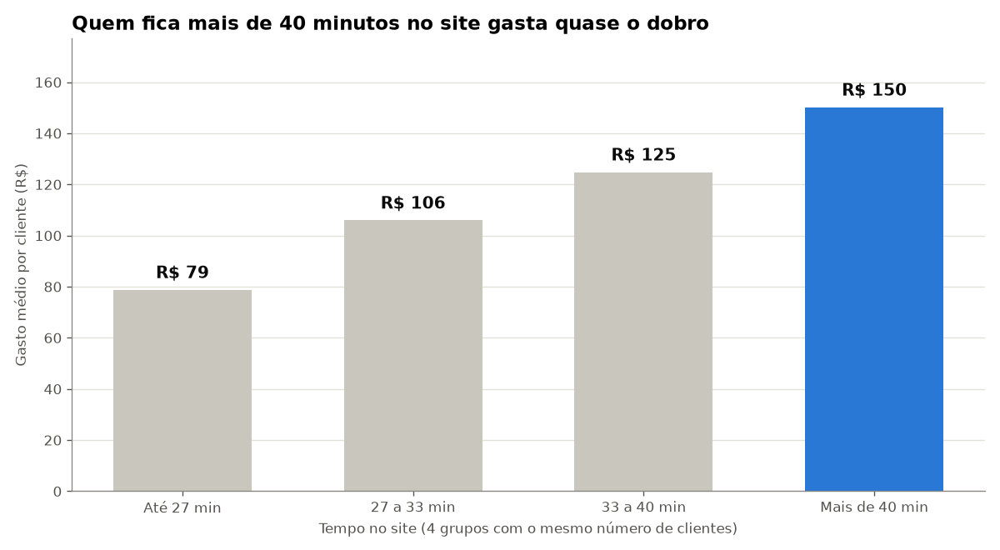
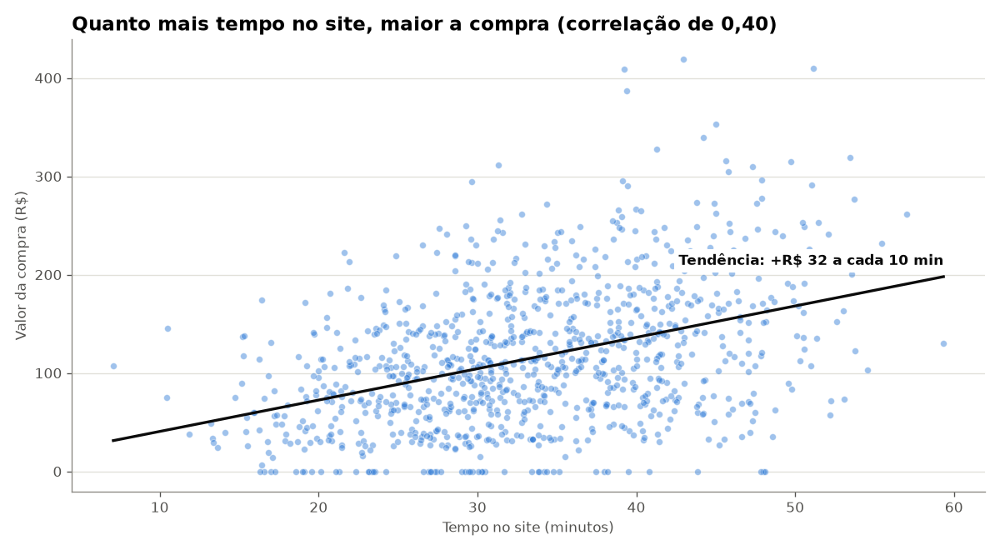
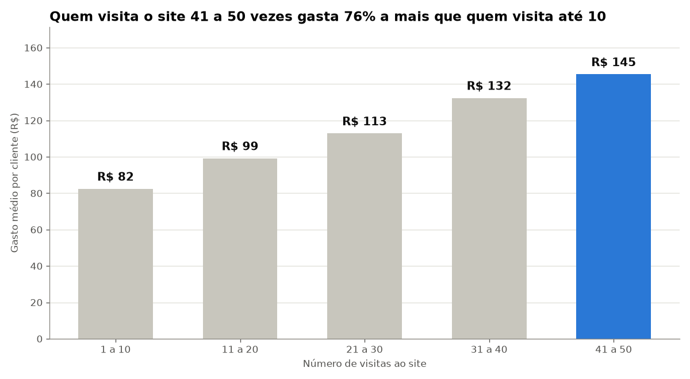
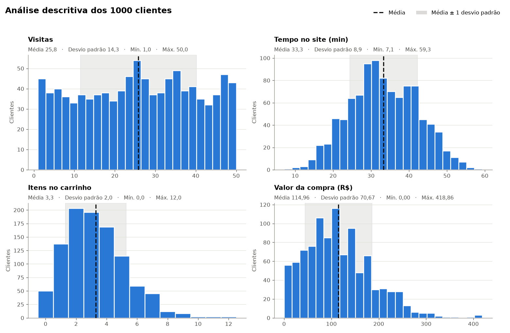

# 🛒 Análise de comportamento de clientes em um e-commerce

Análise exploratória de **1.000 clientes** de uma loja virtual, feita em **Python** com **NumPy, pandas, matplotlib e seaborn**, para responder a uma pergunta de negócio:

> **O que faz um cliente gastar mais?**

📓 **A análise completa, com código, tabelas e gráficos, está no notebook [`analise_ecommerce.ipynb`](analise_ecommerce.ipynb).**

---

## 🎯 A grande ideia

> **Quem fica mais tempo no site gasta quase o dobro. O desafio é fazer o cliente ficar e voltar.**

---

## 📊 Principais descobertas

### 1. Quem fica mais tempo no site gasta quase o dobro



Os 25% de clientes que ficam **mais de 40 minutos** no site gastam em média **R$ 150**, contra **R$ 79** dos 25% mais rápidos. Esse grupo responde por **33% da receita**, e só **2%** deles saem sem comprar (contra **8%** entre os mais rápidos).

### 2. A tendência aparece em toda a base



Cada ponto é um cliente. A linha de tendência mostra que, em média, **cada 10 minutos a mais no site vale cerca de R$ 32 a mais na compra**.

### 3. Quem volta mais vezes também gasta mais



Quem visitou o site **41 a 50 vezes** gasta em média **R$ 145**, contra **R$ 82** de quem visitou até 10 vezes.

### O caminho do dinheiro

**Mais visitas → mais tempo no site → mais itens no carrinho → compra maior**

| Relação | Correlação |
|---|:---:|
| Visitas × tempo no site | 0,81 |
| Tempo no site × valor da compra | 0,40 |
| Itens no carrinho × valor da compra | 0,99 |

---

## 💡 Recomendações

1. **Aumentar o tempo de navegação:** recomendações de produtos ("quem viu também viu"), conteúdo e comparadores.
2. **Trazer o cliente de volta:** e-mail, WhatsApp e remarketing para quem visitou poucas vezes.
3. **Medir o resultado com um teste A/B:** meta de subir o gasto médio do grupo mais rápido de R$ 79 para R$ 100.

---

## 📈 Visão geral dos dados



| Variável | Média | Mediana | Desvio padrão | Mínimo | Máximo |
|---|---:|---:|---:|---:|---:|
| Visitas | 25,83 | 26,00 | 14,35 | 1 | 50 |
| Tempo no site (min) | 33,32 | 32,92 | 8,93 | 7,08 | 59,34 |
| Itens no carrinho | 3,28 | 3,00 | 1,99 | 0 | 12 |
| Valor da compra (R$) | 114,96 | 107,15 | 70,67 | 0,00 | 418,86 |

- **95% dos clientes compraram**, com ticket médio de **R$ 121** entre os compradores.
- Faturamento total: **R$ 114.960**.

---

## ⚠️ Limitações

- **Os dados são simulados** com NumPy. As relações encontradas (visitas → tempo → itens → valor) foram definidas na geração dos dados, explicada na seção 1 do notebook. O objetivo do projeto é praticar o processo completo de uma análise: gerar, explorar, visualizar e comunicar.
- **Correlação não é causa.** Os dados mostram que quem fica mais tempo gasta mais, mas não provam que *fazer* o cliente ficar mais tempo vai aumentar o gasto. Por isso a recomendação 3 propõe um teste A/B.

---

## 🛠️ Tecnologias

- **Python 3.13**
- **NumPy:** geração dos dados (distribuições uniforme, normal e Poisson) e estatística descritiva
- **pandas:** organização dos dados, agrupamentos e correlações
- **matplotlib** e **seaborn:** visualizações
- **Jupyter Notebook**

## ▶️ Como rodar

```bash
# 1. Crie e ative um ambiente virtual
python -m venv .venv
.venv\Scripts\activate        # Windows
source .venv/bin/activate     # Linux/Mac

# 2. Instale as dependências
pip install -r requirements.txt

# 3. Abra o notebook no VS Code (ou no Jupyter) e execute as células
```

Os dados gerados também ficam em [`dados/usuarios_ecommerce.csv`](dados/usuarios_ecommerce.csv) (separador `;` e vírgula decimal), prontos para abrir no Excel ou no Power BI.

## 📁 Estrutura

```
analise_ecommerce.ipynb   notebook com toda a análise
dados/                    dados gerados em CSV
imagens/                  gráficos usados neste README
requirements.txt          bibliotecas e versões
```

---

Feito por **Tiago Dumont** durante os estudos de Python e Ciência de Dados.
